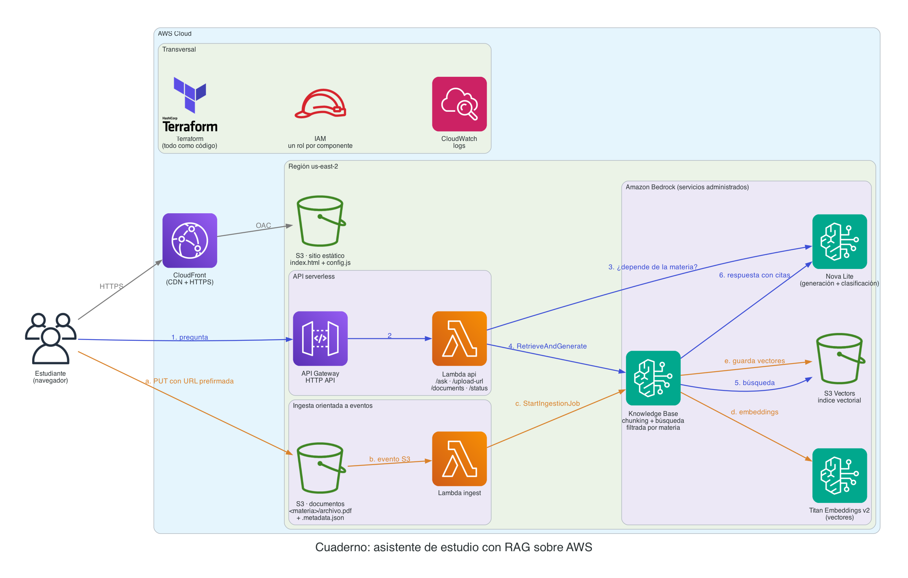

# Cuaderno — asistente de documentos con RAG sobre AWS

Prueba de concepto estilo "NotebookLM": se suben documentos propios, se hacen preguntas en lenguaje natural y la respuesta cita los fragmentos de donde salió. No se entrena ni se hostea ningún modelo: todo se arma con **servicios administrados** de la nube.

## Arquitectura



El diagrama está escrito como código en [`docs/arquitectura.py`](docs/arquitectura.py) con la librería [diagrams](https://diagrams.mingrammer.com/) (íconos oficiales de AWS). Se regenera con `make diagram`. En azul el flujo de consulta y en naranja el de ingesta.

**Flujo de ingesta:** el navegador pide una URL prefirmada a la API y sube el archivo directo a S3. S3 emite un evento, la Lambda `ingest` inicia una sincronización y la Knowledge Base parte el documento en fragmentos de 300 tokens, calcula los embeddings y los guarda en S3 Vectors.

**Materias:** cada documento se sube indicando su materia. Se guarda bajo el prefijo `<materia>/` en S3 junto con un archivo `<doc>.metadata.json` que Bedrock indexa como metadata filtrable.

**Aclaración de materia:** antes de responder, la API revisa si la pregunta nombra una materia. Si no la nombra y hay más de una cargada, una llamada corta al modelo (temperatura 0) clasifica si la respuesta depende de la materia (evaluación, fechas, asistencia…). En ese caso devuelve "¿A cuál te referís?" con botones, y la respuesta siguiente se genera filtrando la búsqueda por esa materia. La materia elegida queda activa para las preguntas siguientes. Las preguntas conceptuales no piden aclaración: la búsqueda ya encuentra el contenido. Se probó primero comparar los scores de la búsqueda, pero los embeddings no separan bien preguntas como "¿cómo se aprueba?" entre syllabus parecidos.

**Flujo de consulta:** la Lambda `api` llama a `RetrieveAndGenerate`. Bedrock busca los fragmentos más parecidos a la pregunta, se los pasa al modelo junto con un prompt que le prohíbe inventar y devuelve la respuesta con citas. El historial de la conversación lo mantiene Bedrock con un `sessionId`.

## Conceptos de cloud que muestra

| Concepto | Dónde aparece |
|---|---|
| Almacenamiento de objetos | Bucket S3 de documentos y bucket del sitio |
| Serverless / FaaS | Dos Lambdas; no hay servidores encendidos |
| Servicios administrados (PaaS/SaaS) | Bedrock: modelos, Knowledge Base y vector store sin operar nada |
| Arquitectura orientada a eventos | Subir o borrar un archivo dispara la reindexación sola |
| CDN y hosting estático | CloudFront delante de un bucket privado (Origin Access Control) |
| API administrada | API Gateway HTTP con CORS y throttling (5 req/s) |
| Infraestructura como código | Todo en Terraform: `make deploy` / `make destroy` |
| IAM y mínimo privilegio | Un rol por componente, cada uno con solo los permisos que usa |
| Pago por uso y elasticidad | Costo ~0 en reposo; S3 Vectors en vez de OpenSearch (que cobra fijo) |
| Etiquetado y costos | `default_tags` en todos los recursos para filtrar en Cost Explorer |
| Metadata y filtrado vectorial | Cada documento lleva su materia como metadata; la búsqueda se filtra por ella |
| Portabilidad | El modelo generador es una variable (`generation_model_id`); se cambia sin tocar código |
| Observabilidad | Logs de las Lambdas en CloudWatch |

## Cómo correrlo

Requisitos: AWS CLI v2, Terraform ≥ 1.6, una cuenta de AWS con Bedrock. Por defecto se despliega en `us-east-2`: las cuentas nuevas creadas como "proyecto" tienen una SCP que solo permite crear recursos regionales en la región asignada (Américas → `us-east-2`).

```bash
make login     # aws login --profile poc (abre el navegador)
make deploy    # ~5 min, la mayor parte es CloudFront
make seed      # sube los documentos de ejemplo de sample-docs/
make url       # URL de la app
make destroy   # borra todo al terminar
```

`sample-docs/` tiene apuntes de Cloud Computing, organizados como `sample-docs/<materia>/` con su `.metadata.json`. El resto de las materias se suben desde la web. Antes de subir material de un curso, sacá los datos personales que tenga (nombres, mails, listas de estudiantes o notas).

## Costos

Estimación para la demo (decenas de documentos, cientos de preguntas): unos pocos dólares, cubiertos por los créditos del plan gratuito. Se paga por token (Nova Lite, Titan Embeddings), por consulta y almacenamiento de vectores (S3 Vectors) y por invocación (Lambda, API Gateway). Nada tiene costo fijo por hora.

## Extras planteados (fuera del MVP)

- **"Todas las materias" comparativo**: hoy "Todas" busca sin filtro; se podría responder una sección por materia.
- **Historial persistente**: guardar conversaciones en DynamoDB (hoy viven en la sesión de Bedrock y se pierden al recargar).
- **Resumen automático**: al subir un documento, otra Lambda genera un resumen y preguntas sugeridas.
- **Autenticación**: Cognito delante de la API (hoy es pública con throttling).
- **Borrar documentos** desde la interfaz (el evento de borrado ya dispara la reindexación).
- **Streaming** de respuestas (`RetrieveAndGenerateStream`).
- **Multi-proveedor**: abstraer el generador detrás de una interfaz para usar Gemini u Ollama además de Bedrock.
- **CI/CD**: GitHub Actions que corra `terraform plan` en cada PR y `apply` al mergear.
- **Observabilidad**: dashboard de CloudWatch con latencia, errores y tokens consumidos, y alerta de presupuesto.
